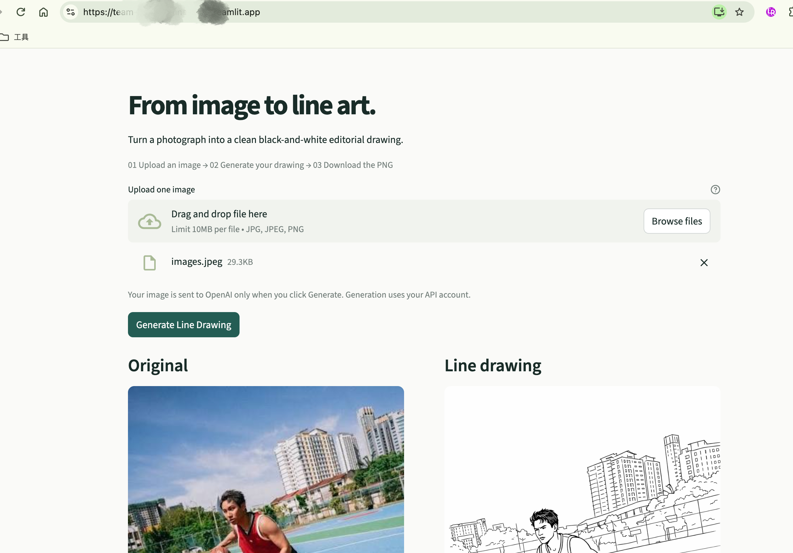
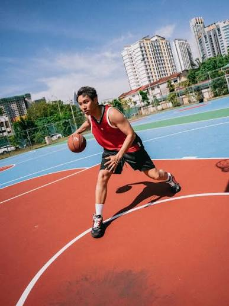
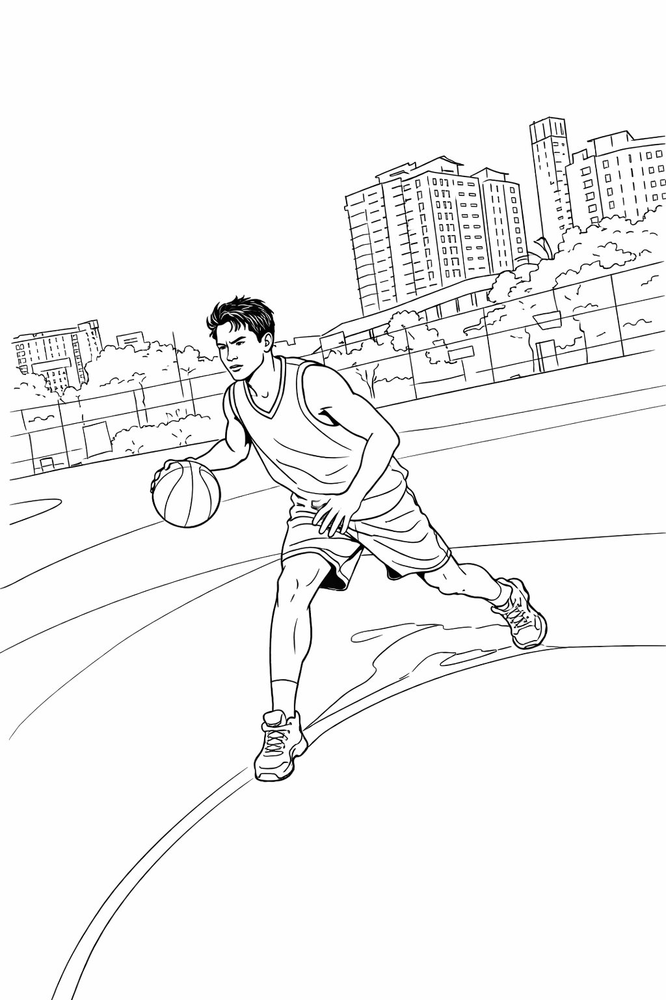

# Generative AI Image Workflow & Illustrated Capstone E-book
### 生成式 AI 图像工作流与 Capstone 插图电子书

## Overview | 项目简介

**EN**  
This repository showcases part of my PMGT5850 Project Management Capstone Project at the University of Sydney. The project focuses on evaluating generative AI image tools and developing a repeatable workflow for producing consistent line-art illustrations for non-technical users.

**中文**  
本仓库展示的是我在悉尼大学 PMGT5850 项目管理 Capstone Project 中的一部分项目成果。项目主要围绕生成式 AI 图像工具评估展开，并尝试建立一套可重复使用的工作流，让非技术用户也能够稳定生成风格一致的线稿插图。

---
## Project Context | 项目背景

**EN**  
The project was initiated to address a practical sponsor need: identifying a suitable generative AI image tool and developing a repeatable process for producing consistent line-art illustrations for an illustrated Capstone tips e-book.

The challenge was not simply to generate individual images, but to determine which platform could provide acceptable style consistency, manageable cost, suitable licensing conditions, and a workflow that could still be used by a non-technical user after project handover.

**中文**  
该项目源于 Sponsor 的实际需求：需要评估并选择合适的生成式 AI 图像工具，同时建立一套可重复使用的流程，用于为 Capstone Tips 插图电子书生成风格一致的线稿插图。

项目的难点并不只是生成单张图片，而是要判断哪个平台能够同时满足风格一致性、成本可控、授权条件适用，并且在项目交付后，非技术用户仍能够继续使用这套流程。

---
## My Role | 我的角色

**EN**  
My main responsibility in the team is Schedule & Risk Management. I built and maintained the Microsoft Project schedule, including task dependencies, milestones, critical-path analysis, resource planning, and schedule risk tracking.

I also independently developed and deployed a web prototype to demonstrate the project's black-box workflow concept.

**中文**  
我在团队中的主要职责是进度与风险管理。我使用 Microsoft Project 搭建并持续维护项目进度计划，包括任务依赖关系、里程碑、关键路径分析、资源规划以及进度风险跟踪。

此外，我还独立开发并上线了一个网页原型，用于展示项目中的“黑盒工作流”概念。

---

## Web Prototype | 网页原型

**EN**  
The prototype provides a simple interface for users to upload an image and generate a corresponding line-art output.

**中文**  
网页原型提供了一个简单的操作界面，用户可以上传图片并生成对应的线稿结果。

### Prototype Interface | 原型界面

### Before & After | 生成前后对比

<table>
  <tr>
    <th>Before | 原图</th>
    <th>After | 线稿</th>
  </tr>
  <tr>
    <td></td>
    <td></td>
  </tr>
</table>

**EN**  
The prototype simplifies the workflow into:

**Upload an image → Generate → Receive a line-art output**

The application integrates an image-generation API and hides the technical complexity behind a simple user interface.

My work included:
- Web interface development
- API integration
- Deployment
- Paid API configuration
- End-to-end testing with real image inputs

**中文**  
该原型将整个流程简化为：

**上传图片 → 点击生成 → 获得对应线稿**

应用接入了图像生成 API，并通过简单的用户界面将后端技术流程封装起来，使用户不需要理解复杂的 Prompt、模型参数或 API 配置。

我的具体工作包括：
- 网页界面开发
- API 接入
- 网站部署上线
- 付费 API 配置
- 使用真实图片进行端到端测试

---

## Tools & Technologies | 工具与技术

- Microsoft Project
- Python
- Streamlit
- Generative AI
- Image-generation API
- GitHub

---

## Current Status | 当前状态

**EN**  
This project is still in progress. Current work includes:
- Refining sponsor requirements
- Validating the reusable workflow
- Improving output consistency
- Producing the final image set
- Developing the illustrated Capstone e-book

**中文**  
该项目目前仍在进行中。当前主要工作包括：
- 进一步明确 Sponsor 的需求
- 验证工作流是否具备可重复使用性
- 提高线稿输出的一致性
- 制作最终图片集
- 完成 Capstone 插图电子书

---

## Repository Scope | 仓库范围

**EN**  
This repository is intended as a portfolio showcase of my contribution to the project. Confidential sponsor materials, internal team documents, API credentials, and assessment-sensitive files are not included.

**中文**  
本仓库主要用于作品集展示，重点呈现我在该项目中的个人贡献。涉及 Sponsor 的保密资料、团队内部文件、API 凭证以及与课程考核相关的敏感文件不会上传至本仓库。
